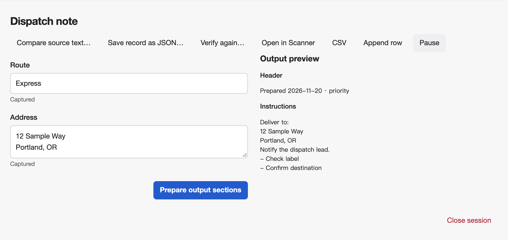

# VeraFlow

English · [简体中文](README.zh-CN.md)

VeraFlow is a local desktop app for collecting information, checking it in one form, and reusing the same record for outputs such as emails, tickets, and spreadsheet rows. It runs on macOS and Windows. VeraFlow has no account, analytics, or AI service. It contacts GitHub for update checks and downloads.

**Source → working record → named outputs → destination**

| What you have                                     | How it fits                                                                                                                                                  |
| ------------------------------------------------- | ------------------------------------------------------------------------------------------------------------------------------------------------------------ |
| Typed values, selected text, or a UTF-8 text file | Enter or capture values, or extract candidates from labeled lines and review them.                                                                           |
| CSV, flat JSON or JSON5, or candidate JSON        | Select a CSV row, open a JSON record as a filled form, or review proposed values and supporting evidence.                                                    |
| XML, YAML, or a nested JSON export                | Use an external converter to map the fields you need into flat record JSON or CSV. Use candidate JSON when a person needs to review uncertainty or evidence. |
| A checked working record                          | Prepare named outputs. Copy or paste text sections, save text or record JSON, or use the CSV tools to append a row.                                          |

JSON is an exchange format for the record. When you fill a form directly, VeraFlow holds the working values in memory. JSON5 is supported for incoming flat records and in the header of a `.veraflow` or `.vf` file. Record exports and candidate files use strict JSON. [Import and output guide](docs/veraflow-language-draft.md#working-records-and-external-converters)



Try the [Dispatch note example](examples/source/dispatch-note.veraflow) to see the live preview. Try [Shipment follow-up](examples/source/shipment-steps.veraflow) to see how Steps carry verified values across several outputs.

## Install

Get the [v0.25.1 preview binaries](https://github.com/iandorsey00/veraflow/releases/tag/v0.25.1): macOS Apple Silicon (`macos-arm64.zip`), macOS Intel (`macos-x64.zip`), or Windows x64 (`windows-x64-setup.exe`). Compare downloads with the release’s `SHA256SUMS.txt`. Node.js and Rust are only needed to build from source.

- **macOS 12+**: Extract the ZIP and move VeraFlow.app to Applications. The preview is not Developer ID signed or notarized. If macOS blocks it and you trust the download, use the per-app **Open Anyway** option in Privacy & Security. Give VeraFlow Accessibility permission for cross-app capture and paste.
- **Windows**: Run the installer. Windows may show an unrecognized-publisher warning, and the installer may install WebView2 if needed.

If an update is available, **Update app…** appears in the menu-bar or tray menu. You can also check from Settings. Back up [your local library](#local-data-and-rollback) before upgrading.

## Open a form or folder

- **Open folder…** lists `.veraflow` and `.vf` files, including files in subfolders. Search by file name or relative path, pick a form or snippet collection, and use **Refresh folder** after editing the collection outside VeraFlow. The folder stays open while you work through sessions. Create and organize folders in Finder or File Explorer.
- **Open file…** opens a form, snippet collection, or CSV directly. You can also double-click a VeraFlow file or use your file manager’s **Open With → VeraFlow**. In the CSV picker, search for a row and open it in a custom form or use it to fill a form from disk.
- **Open JSON / JSON5…** lets you paste data or open a file, review the values, and generate output from a filled form. Use a summary, write your own output text, or choose a form file. [Try the JSON demo](examples/source/json-demo.md).
- A form file can [link a CSV](docs/veraflow-language-draft.md#linked-csv) and open directly to Output. Choose a row and a named output, or use the arrow buttons to step through combinations.
- Use **Append row** to review and add the working record to a CSV, or copy it for pasting into a spreadsheet. [Append row guide](docs/veraflow-language-draft.md#append-row)
- Open a [snippet collection](docs/veraflow-language-draft.md#snippet-collections) to copy reusable text with one click.
- **Create form** opens a custom form for an ad hoc task. Define one field per line or import a field list. Use **Form tools** to set a verification default or export the field list and values. Existing library templates and JSON exchange remain available under **Settings → Legacy template library**.

A form file can be as simple as `Hello {{name}}`. The [source file guide](docs/veraflow-language-draft.md) covers shared records, named outputs, source comparison, and paste sections. The [examples](examples/source/README.md) include an address, a sample CSV, and a page to test paste navigation. The [VS Code extension](editors/vscode/README.md) adds highlighting, folding, and snippets. The release page also includes `VeraFlow_VSCode.vsix`. The [portable specification](docs/portable-templates.md) includes a simpler template profile, fixtures, and an independent Python reader.

## Fill, verify, and transfer

On a source form, **Extract from source…** brings in a block of text. **Form tools** contains record import and export, source comparison, and CSV actions. **Needs attention** near the top shows how many values or checks are pending.

1. Type or paste values into the form, or select text in another app and use **Capture** beside the field.
2. Use **Verify field** to compare a value against the original. VeraFlow keeps your value and shows the difference if they disagree. **Needs attention** links to missing values and required checks. Press **Alt+Shift+N** (**Option+Shift+N** on macOS) to jump to the next item. Unfilled optional fields are under **Optional details**.
3. Review the preview and prepare the output. Use **Paste options → Reorder sections…** to adjust the paste order for your destination. A custom order uses one section per shortcut and sends no navigation keys. When closing, choose **Save to recent forms** to resume from **Recently opened forms**, or **Save prefilled form** to reopen a separate file. Prepared output also appears in **Recent outputs** for copying.

The default output shortcut is **Ctrl+Alt+X** on Windows and **Cmd+Opt+X** on macOS. The other actions use Ctrl+Alt+1–7 or Cmd+Opt+1–7. Existing shortcut preferences are kept on upgrade. Change them in Settings. Some protected apps block synthetic input, so copy and paste manually if direct transfer fails. When a paste fails partway through, inspect the destination before resuming; the pending output stays available to copy.

Use **Settings → Keep the session window on top** to keep the form visible while working in another app. Pausing returns to the launcher and releases the pin. [Five-minute housing demo](examples/source/housing-demo.md). Download `VeraFlow_Demo.zip` from the release page. The [display replacement demo](examples/source/service-demo.md) walks through bulk extraction, candidate review, and verification.

On macOS, **Save as PDF…** reviews the prepared Markdown and converts it locally using installed Pandoc and XeLaTeX. You can also save the editable Markdown. [Setup and fictional résumé demo](examples/source/pdf-demo.md) · [Command-line usage](examples/source/pdf-demo.md#run-from-the-command-line)

Use the [VeraFlow CLI](docs/cli.md) to inspect forms, validate and merge records, review extraction evidence, and render outputs from scripts or AI tools.

## Local data and rollback

Settings and the older template library are stored in `library.json` under `~/Library/Application Support/com.veraflow.desktop/` on macOS or `%APPDATA%\com.veraflow.desktop\` on Windows. Quit VeraFlow before backing up or restoring that file. Keep a pre-upgrade backup for a rollback; older versions may reject settings or definitions from this release. Existing saved data is retained in place. Saved forms, prefilled source files, and exported results are plain text and may contain private information.

See [release and rollback instructions](docs/release.md), [release notes](CHANGELOG.md), and [known limitations](docs/binary-release-notes.md).

## Run from source or try a test build

Requirements: Node.js 22.12+, stable Rust, and the [Tauri build prerequisites](https://v2.tauri.app/start/prerequisites/).

```sh
npm ci
npm run desktop
```

Use `npm run dev` for a browser-only preview without native transfer, menu-bar integration, or persistent storage. For isolated **VeraFlow Test** installers, see the [preview guide](docs/source-preview.md) and the `preview-source.*` builds on [Releases](https://github.com/iandorsey00/veraflow/releases). Test builds keep a separate library. [Windows test instructions](docs/windows-testing.md) explain how to try CI artifacts.

VeraFlow © 2026 Ian Dorsey. Open source under the [MIT license](LICENSE). [View the repository on GitHub](https://github.com/iandorsey00/veraflow).
