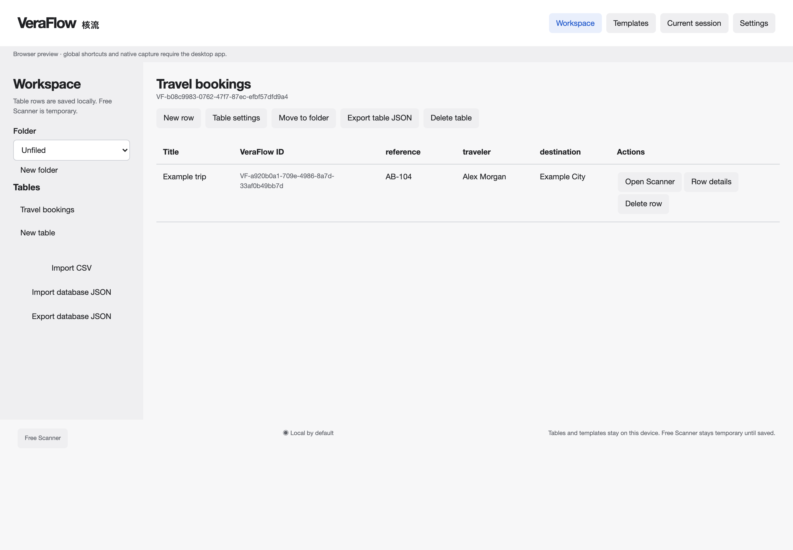

# VeraFlow 核流

A local desktop utility for capturing, verifying, and reusing text. Organize repeatable work into folders and tables, open rows in Scanner, or use reusable templates for structured output.

Built for macOS and Windows with Tauri 2, Rust, and TypeScript. No account, analytics, or AI service. The app contacts GitHub for update checks and downloads; template and session values stay local. Preview binaries use verified updater signatures but do not yet have Apple notarization or Windows publisher signing. Native runtime acceptance remains incomplete.



## Focused workflow trial (this branch)

The `codex/focused-workflow` branch adds an active-field view, a compact checklist, explicit source-match/transfer messages, and in-memory Pause/Resume. **Classic view** stays available without losing session values or unfinished typing. Saved-library format and public 0.8.1 downloads are unchanged.

Start with the [Focused workflow guide](docs/focused-workflow.md) for a two-field exercise, keyboard/mouse instructions, email recovery, saving, and switching back. Each branch check builds an isolated Windows **VeraFlow Test** installer after its checks pass; it uses a separate library and leaves the public updater untouched.

## Workspace preview (0.7.0)

The app opens to **Workspace**. Organize work into folders and tables; column headers are field names, and each row opens in Scanner. Tables and rows have stable VeraFlow IDs. Add labeled external IDs in Table settings or Row details, for example `Booking=AB-104`. External IDs are references, not unique keys. Tables can show optional row titles or hide them. Open each table’s collapsible Snippets section for titled literal text, or use Unfiled snippets in the sidebar. Existing templates remain available under Templates; there is no duplicate Scanner tab.

**Free Scanner** is at the bottom of the main pages. Define field names, one per line, or import Scanner JSON. Values stay temporary until **Save as new table row**: enter an existing table name/ID to append a row, or a new name to create a table. Existing table names must be unambiguous. **Save row** explicitly persists edits to a linked row. Ending Scanner clears unsaved session values, not saved rows. Reopening a saved row resets values to captured and requires fresh verification before output when enabled.

Scanner wraps long values. Select a field and use Verify, Rename, Copy, or Paste below the list. Right-click a field for the same actions beside the pointer. **Tab / Shift+Tab** moves between fields; Tab from the last field leaves the list so the remaining controls remain reachable. **Ctrl/Cmd+C** copies the focused field through the verification gate; normal selected-text copying remains native. **Paste field to last app** returns focus to the most recent external app and requests Paste without Tab. Place the cursor in the intended destination first, keep mouse mode enabled, and inspect the result before retrying. Windows cross-app acceptance is still required. The existing output shortcut also supports Copy, Paste, and Paste+Tab. No operation sends email.

Under Scanner → More tools, use `{{field name}}` references. The preview marks matching names green and missing names red, with text labels for both. **Add missing fields** creates the missing names. Copy template output checks only referenced fields and their verification. Literal text with no fields can also be copied; a fieldless table can store reusable text under Table settings. Escape literal opening braces with `\{{`.

Scanner's More tools → JSON section exports **fields only** or **fields and values**. Imported values are captured, never already verified. Mismatched values and verification candidates are excluded. Workspace exports either a table or the database; both use the same versioned JSON format. Import adds data and preserves IDs where possible, assigning fresh IDs to collisions instead of overwriting existing work. Table/database JSON contains saved values; review files before sharing. Template JSON remains separate and excludes captured values.

Rows, templates, and preferences use the existing atomically saved local library (16 MB total). This first version does not sync, encrypt app data, or provide multiuser editing. Export database JSON for a portable backup; export templates separately. Back up `library.json` before upgrading: older versions reject the new workspace property and shortcut migration marker. Rollback requires restoring a compatible pre-upgrade library. VeraFlow Test uses a separate library; export/import its database and templates explicitly to move them to the public app.

Version 0.7.0 brings the workspace to the public preview. The current email workflow remains available; macros, row combination, and a unified Scanner/email editor are deferred.

### CSV and template setup

Choose **Import CSV** in Workspace, then review the first five rows and the **Use first row as headers** checkbox before importing. Header detection is a suggestion; turn it off when the first row contains data. Comma, semicolon, and tab delimiters are detected. UTF-8 BOMs, quoted commas, doubled quotes, and multiline cells are supported. Blank, invalid, or duplicate headers receive unique names; ragged rows and malformed quotes are rejected. Imported values are plain text, including formula-looking cells; no formulas, links, or macros execute. Import creates a new table in the selected folder without overwriting data. Preview/import respects the local size limits, including JSON expansion from long repeated column names.

Excel is not imported directly in this release. Export the intended sheet as **CSV UTF-8** from Excel, then import that file. Formatting, formulas, and multiple-sheet structure are not carried over as workbook features.

Free Scanner and Table settings can infer fields from a supplied template when the field list is blank. Brace placeholders support spaces, such as `{{full name}}`; surrounding padding is ignored (`{{ full name }}` matches `full name`). Internal spaces remain significant. Line breaks and control characters are invalid within placeholders. Legacy angle syntax stays unchanged. Scanner opens at 360px wide and can shrink to 300px; controls and long values wrap instead of widening the page.

## Extra Scanner fields (0.7.4)

Templates and email templates have an optional **Extra Scanner fields** input: one name per line, with spaces allowed. Empty lines and repeated names are ignored; a name also used by a placeholder is captured once. Extra fields appear in capture order and use the template's verification rules. They do not add text or placeholders to Body, Subject, To, Cc, or Bcc.

After copying an ordinary template with extra fields, or completing email output, choose **Open fields in Scanner** to transfer individual values or **Clear fields and close** to erase them. The review remains guarded against accidental quit/update. This explicit choice defers automatic session erasure until you choose; templates without extras retain their existing completion behavior. Explicitly skipped fields are omitted from the Scanner transfer. Definitions are saved and included in template JSON; captured values and verification candidates are not. Values persist only through a separate explicit Save row or value export.

Back up the library before upgrading. Version 0.7.0 and earlier reject saved `extraFields` definitions; rollback requires restoring a compatible pre-upgrade library backup.

## Defaults

Fresh installations include generic English and Chinese email templates with separate Subject/To/Body and `{{double_braces}}` placeholders. Blank new templates also use braces. Legacy angle syntax remains optional so existing templates and imports keep working; no automatic text rewriting occurs. Existing libraries and templates are preserved.

Global shortcuts default to Ctrl+Alt+1–8 on Windows (Cmd+Option+1–8 on macOS). Previously unchanged stock Ctrl+Shift bindings migrate once to these defaults; later explicit changes are respected; customized bindings remain untouched, and migration avoids collisions with existing shortcuts. Local Cmd/Ctrl+Enter and Alt+Left/Right remain available.

## Download

Get the [v0.8.1 preview binaries](https://github.com/iandorsey00/veraflow/releases/tag/v0.8.1): macOS Apple Silicon (`macos-arm64.zip`), macOS Intel (`macos-x64.zip`), or Windows x64 (`windows-x64-setup.exe`). Verify downloads against the release’s `SHA256SUMS.txt`. No Node.js or Rust installation is needed to use these binaries.

On macOS 12+, extract the ZIP and move VeraFlow.app to Applications. The preview is not Developer ID signed or notarized; macOS may block opening it. Use the per-app Open Anyway option in Privacy & Security only if you trust the download. Grant Accessibility permission there for source-text capture. On Windows, run the installer; it may show an unrecognized-publisher warning and install WebView2 if missing. Do not disable system-wide security protections.

Back up `library.json` before upgrading. See [release and rollback instructions](docs/release.md) and [preview limitations](docs/binary-release-notes.md).

## Run

Requirements: Node.js 22.12+ (tested with 24), current stable Rust, and platform build tools. macOS requires Xcode Command Line Tools; Windows requires Visual Studio Build Tools with Desktop development with C++ and WebView2. See [Tauri prerequisites](https://v2.tauri.app/start/prerequisites/).

```sh
npm ci
npm run desktop
```

For a browser-only UI preview: `npm run dev`. Preview libraries are memory-only and reset on refresh. Global shortcuts, native capture, tray, login items, and filesystem storage require the desktop app.

```sh
npm test
npm run check
npm run test:ui           # first run: npx playwright install chromium
cargo test --manifest-path src-tauri/Cargo.toml
cargo clippy --manifest-path src-tauri/Cargo.toml -- -D warnings
npm run desktop:build    # unsigned local platform bundle
```

macOS bundles appear under `src-tauri/target/release/bundle/`. Windows builds produce MSI/NSIS bundles on Windows. Release signing/notarization certificates are intentionally not included. CI checks both platforms. Version tags run the release workflow, which packages three binaries, verifies uploaded checksums, and publishes an unsigned GitHub prerelease.

## Workflow

1. Create or edit a template with placeholders such as `{{ticket_number}}`, `{{客户姓名}}`, or `{{地址}}`. Repeated names share a field. Use a folder label to organize templates, and arrow buttons to change capture order.
2. Start a session. The same window becomes a small, resizable, always-on-top panel. Return to the source app and select text.
3. Press the capture shortcut. The panel stores the text and advances. You can also paste/type manually, or copy in the source app and choose **Use clipboard**. Cmd/Ctrl+Enter opens manual entry or submits and advances. Alt+Left/Right moves to the previous/next field within VeraFlow.
4. After the last field, verification starts if enabled. Select each original value again and press the verification shortcut. A mismatch shows both values and emphasizes the differing span; it never overwrites the captured value.
5. Preview if desired, then choose **Copy result** or use the finish shortcut. Values are erased by default after successful copying. Skipped fields render as empty text.

With a template selected, **Cmd/Ctrl+Enter** starts its session. Use Tab/Shift+Tab and Enter/Space to operate the remaining controls. In Settings → Verification, **Green background for verified fields** optionally colors each verified field as it passes (off by default).

Default global shortcuts use **Cmd/Ctrl+Alt+1…8**: capture, previous, next, clear, skip, verify/start verification, cancel, and finish. All are configurable in Settings, registered only during sessions, and paused while the template/settings screen is shown. A registration conflict identifies the action and combination; a new session still opens with global shortcuts disabled for that session. Use manual entry, clipboard, or the mouse panel. Settings offers an alternate Cmd/Ctrl+Alt+Shift preset, a global-shortcut toggle, and blank combinations to disable individual actions. Capture can also verify during the verification pass. Capture and verification shortcuts always advance after success; the automatic advancement preference controls the manual buttons. Release shortcut modifiers promptly so copy/paste can run; VeraFlow waits up to three seconds and reports held keys separately. Cmd/Ctrl+Shift+N may already be assigned by the system or another application; use Cmd/Ctrl+Alt+N if that combination works on your machine. Registration conflicts cannot be overridden by VeraFlow.

The **Verify** shortcut starts the second pass when capture is complete; subsequent presses retrieve source text. Without automatic advancement, use next/previous and start verification explicitly. All populated fields must pass when verification is required. Clear a field to recapture it; corrections invalidate its verification. Cancellation, replacement, quitting an active session, and discarding unsaved changes require confirmation.

## Comparison

Comparison is deterministic and local. Newlines normalize CRLF and CR to LF. Optional NFC normalization handles canonically equivalent Unicode. Exact mode preserves spaces; whitespace mode trims and collapses whitespace, optionally preserving line boundaries. Case-insensitive comparison uses locale-independent Unicode lowercase, not language-specific case folding. Punctuation tolerance is off by default. Width variants, lookalikes (`0`/`O`), and fuzzy meanings do not match automatically. Comparison never transforms output values.

New templates use `{{name}}`; existing templates keep their selected syntax, including legacy `<name>`. Choose either syntax per template; changing the setting does not rewrite the text. Double-brace names are case-sensitive, support internal spaces, and trim whitespace just inside the braces. Legacy angle fields retain their original syntax rules. Braces preserve display-name addresses such as `Joe Smith <joe.smith@example.com>`. Escape an opening delimiter with a backslash (`\<literal>` or `\{{literal}}`); `\\` produces one literal backslash. Other backslashes are unchanged. Replacement is literal and never reparses inserted values.

## Architecture and storage

- `src/core/`: pure parsing, comparison, rendering, and session state.
- `src/main.ts`, `src/style.css`, `src/locales/`: keyboard-accessible DOM UI and English / Simplified Chinese resources.
- `src/platform.ts`: desktop boundary and explicitly limited browser preview.
- `src-tauri/src/`: typed local persistence, tray, lifecycle, and native capture bridge.
- `src-tauri/native/`: Objective-C macOS and Win32 C++ clipboard adapters.

[Architecture decision](docs/architecture.md) records the framework tradeoffs and use of `../guidelines`. [Privacy and security review](docs/privacy-security.md) describes the limits of clipboard restoration and in-memory privacy. [Validation](docs/validation.md) distinguishes automated checks from manual release gates.

Templates and preferences are stored as `library.json` under the OS app-data directory: `~/Library/Application Support/com.veraflow.desktop/` on macOS and `%APPDATA%\com.veraflow.desktop\` on Windows. Writes replace the file atomically, with restrictive permissions on macOS. An unreadable library fails closed instead of being overwritten. Back up this file while the app is closed; restore it with the app closed. Templates themselves may contain sensitive static text and are not encrypted by VeraFlow.

Session values, mismatch candidates, and rendered output are never written to application storage or logs. Session persistence is not offered; quitting always drops in-process data. Erasing references is not secure memory wiping, and OS swap/crash dumps or clipboard managers are outside the app's control.

## Platform limitations

- **macOS:** grant VeraFlow Accessibility permission in System Settings → Privacy & Security → Accessibility. Capture first reads accessible selected text. If unsupported, it sends Cmd+C, snapshots readable clipboard formats up to 32 MiB, and restores them if the clipboard is unchanged. macOS has no atomic pasteboard compare-and-swap, so restoration remains best effort. Some apps expose neither selection nor Copy.
- **Windows:** uses Ctrl+C fallback. It preserves supported global-memory formats and refuses unfamiliar formats before copying when restoration is enabled. Elevated/protected apps may block synthetic input. VeraFlow does not request administrator privileges.
- Clipboard history, Universal Clipboard/cloud clipboard, other clipboard managers, delayed-copy operations, secure input, or another app changing the clipboard can prevent reliable restoration. No copy-result provenance can be guaranteed against another process writing at exactly the same time. Errors leave the field unchanged and offer manual capture. If preservation prevents capture, turn off **Preserve clipboard for this session** in the capture panel, then retry the shortcut or Transfer. This explicitly lets capture replace the current clipboard. Clipboard preservation is off by default, including a one-time migration of existing preferences. Capture therefore replaces the clipboard unless you explicitly opt in to restoration in Settings. New sessions reset to that saved choice.
- Global capture requires source focus. The optional session-only **Mouse transfer panel** remembers the most recent external application/window while enabled, restores its focus on Transfer, and captures the selection. It starts enabled on each new session and can be turned off; no selected text is monitored. Drag the floating window beside your source and keep Always on top enabled. Apps that clear selection on focus changes may require the keyboard or clipboard route. Automatic popups beside selections are not implemented.
- No crash reporting or telemetry is configured. The operating system may independently collect crash information. No guarantee is made against force quit, power loss, OS dumps, or malicious local software.

## Screenshots

Run `npm run dev`, then `npm run portfolio:capture`. The capture script uses only synthetic browser-preview data. See [screenshot manifest](docs/portfolio/README.md).

## Releases

See [release notes](CHANGELOG.md) and [build, installation, and rollback instructions](docs/release.md). Version consistency is checked with `npm run check:version`.

## License and source

VeraFlow © 2026 Ian Dorsey. Open source under the [MIT license](LICENSE).

[View the repository on GitHub](https://github.com/iandorsey00/veraflow). The app also includes these details under Settings → About; the repository link opens your default browser.

## Email mode

Enable **Email mode** on a template to add Subject and To above the Body. Cc and Bcc have separate toggles and are off initially. Blank new templates start with email mode off; the included email examples have it enabled. Every enabled section accepts placeholders; repeated names share one captured and verified value. Disabled sections are excluded from capture and output. To and any included Subject must resolve to nonempty single-line text.

After capture and verification, choose **Prepare email output** (or press the configured finish shortcut once). Focus the first included section in the destination email app. Press **Cmd/Ctrl+Alt+8** for each section in the template’s configured paste order. The default is Subject → To → enabled Cc → enabled Bcc → Body. Each press pastes once and presses Tab; Body does not press Tab. **Cmd/Ctrl+Alt+2** sends Shift+Tab and returns to the previous section. These use the configurable finish and previous shortcuts. Returning does not undo pasted text: select existing text before repasting. VeraFlow never sends the email.

The destination must expose the same field order and optional fields; adjust focus manually when its Tab order differs. Output replaces the clipboard and does not restore it. Slow editors, recipient chips, or focus changes can prevent the intended result; inspect the destination before retrying any failed paste. **Next section (manual)** and **Previous section (manual)**, or Alt+Right/Left inside VeraFlow, change only VeraFlow’s section without sending Paste or Tab. The configured global Next shortcut (default Cmd/Ctrl+Alt+3) also advances manually while your email app stays focused. Use these after inspecting or manually filling a section if injection fails. At Body, manual Next enables finishing; this does not claim the body was pasted. Adjust destination focus yourself. After the Body, review your draft, return to VeraFlow, and use **Cmd/Ctrl+Enter** to complete the transfer. Then choose Open fields in Scanner for individual copying/pasting, or Clear fields and close. Values remain only in memory, with quit/update guards active until you choose. Browser previews cannot inject keys into another app.

Templates without email configuration load with email mode off. Back up `library.json` before saving email templates: older binaries reject the additional template property, so downgrading requires a compatible backup.

## Template exchange and updates

**Export JSON** saves saved templates only, including email sections, comparison settings, and placeholder style. It excludes captured session values and app preferences. **Import JSON** validates a versioned VeraFlow archive, previews template names for confirmation, and adds copies with fresh IDs without overwriting existing templates. Archives are limited to 16 MB and libraries to 1,000 templates. XML is not supported. Templates can themselves contain private literal text; review them before sharing.

Desktop startup checks once for a newer version without interrupting editing. When one is available, **Update now** appears on the main page. **Update app** in Settings also checks on demand. Review the version and release notes, then confirm to download, verify, install in place, and restart. Save or discard changes and finish or cancel any session first. Saved templates and settings stay in the app-data directory. There is no background installation, and a failed startup check stays quiet; use Settings to retry. Windows shows installer progress; macOS may request permission to replace the app. Install macOS builds in a stable writable location such as Applications.

Version 0.4.0 and earlier need one manual upgrade to 0.5.0 to gain this feature. The preview update feed is published only after all three platform packages pass signature and checksum verification. Update signatures verify package identity and version; they do not replace Apple notarization or Windows publisher signing, which remain unconfigured.

## v0.5.1 recovery improvements

Version 0.5.1 adds session-only clipboard recovery, individual verified-field backgrounds, manual email navigation, clearer confirmation actions, specific held-key/permission errors, and the main-page update action. Version 0.5.0 users can install this release through Settings → Update app. Earlier versions need a manual download. All release checks and package signature/checksum verification passed. A live Apple Silicon upgrade verified package replacement and saved-library retention; visible relaunch and Windows/Intel interactive upgrade acceptance remain unconfirmed.

## v0.6.0 workflow features

- Mouse transfer starts enabled in each session; uncheck **Mouse transfer panel** to use keyboard-only capture. It still remembers application/window identity only and never monitors selected text.
- Templates now have **Email paste order** with keyboard-accessible up/down controls. Body stays last. To use To → Cc → Body, disable **Include Subject**, enable Cc, and move To above Cc. Fill any excluded Subject yourself in the email app. The default and older templates keep Subject → To → Cc → Bcc → Body. Enabled sections are shown and pasted in the saved order.
- Select a populated field and choose **Remove blank lines** to remove empty or whitespace-only lines from an address. Nonblank lines keep their spaces and line breaks. The action invalidates verification; subsequent verification applies the same blank-line removal to source text for that field. Clear and recapture to disable it. Other fields and template text are unchanged.

JSON exports include the optional Subject toggle and paste order. Old libraries and JSON exports still load with the previous behavior. Older binaries reject newly saved email properties, so keep a compatible library backup before downgrading. Version 0.5.x can install this release through Settings → Update app; earlier versions need a manual download.

The v0.6.0 release passed 48 automated tests on each supported CI platform, native compilation checks, and updater signature/checksum verification. Native cross-app acceptance and visible updater relaunch remain the preview limitations recorded in [validation](docs/validation.md).

## Latest release: v0.6.2

Sessions use a compact heading, with manual entry directly below it and expandable session options and guidance. Status notices have balanced spacing, and template import/export controls are separated from the list.

Capture order retains header fields while email mode or individual headers are disabled, including across saves and template JSON transfers. Only enabled fields appear in a session. Deleted placeholders are removed from the remembered order.

Leaving or completing a session restores the pre-session window bounds. Windows uses the saved normal window placement to leave a session that was snapped or maximized; macOS restores its saved size and position. Windows 11 top/bottom Snap behavior still needs an interactive check on a real Windows desktop.

Release verification: all 56 core, Rust, and browser/accessibility tests passed on each CI platform, along with native compilation and the platform-specific native checks. All three binary packages passed updater-signature and downloaded-checksum verification. The v0.6.2 update feed is live for Windows x64 and both Mac architectures. Binaries remain publisher-unsigned previews.

## Previous release: v0.6.1

Clipboard preservation starts off for new and existing installations. Existing preferences migrate once; later explicit opt-in in Settings is respected. Capture replaces the clipboard while restoration is off.

Email output removes surrounding header whitespace and trims the edges of values substituted into headers, including copied trailing newlines and tabs. Captured values, verification input, and Body text remain unchanged. Genuine internal header line breaks, tabs, controls, and Unicode line/paragraph separators are still blocked; errors now identify the affected section (Subject, To, Cc, or Bcc). Keep recipient lists on one line, separated with commas.

Publisher signing requires credentials that are not yet available. Updater signatures remain enforced, but these binaries are still publisher-unsigned previews. See [publisher signing setup](docs/signing.md). Back up library.json before upgrading: the new clipboard migration marker is rejected by older binaries, so downgrading requires a compatible pre-upgrade backup.

Release verification: all 54 tests passed on each CI platform, along with native compilation, update-signature verification, and downloaded-checksum verification. The v0.6.1 update feed is live for Windows x64 and both Mac architectures.

Export this template shares the selected template’s current edits as `veraflow-template.json` without saving the draft. Import one template adds a fresh copy from a single-template JSON file; use Import JSON / Export JSON for the whole template library. Both formats contain definitions only, never captured session values. Scanner and verification text wrap within narrow windows, including mismatch comparisons.

Drag dotted handles to reorder template capture fields, email headers, and Scanner fields; arrow buttons remain available for keyboard use. Email Body stays last. Scanner reordering keeps values and verification with their fields and is session-local (saved tables keep their column order). Update now appears in the main navigation when a newer version is available; Settings has its update action beside the heading. Windows placement uses consistent DPI coordinates to avoid size growth after sessions.

Version 0.7.4: select a session field and press Ctrl+V (Cmd+V on macOS) to capture text, or compare it during verification. Text boxes keep normal paste behavior. **Verify again…** offers the selected field or all filled fields and preserves the captured text. Scanner hides drag handles and arrow controls by default; choose **Reorder fields** to show them and **Done reordering** to hide them. Template capture-order and email paste-order controls remain visible.

Table snippets (0.8.1): each table has a collapsible **Snippets** section for titled, literal text with no fields or verification session. **Unfiled snippets** in the Workspace sidebar holds snippets without a table. Use **New snippet**, enter a required title and text, then choose its table or Unfiled. **Edit snippet** changes its title/text; **Move snippet** changes its location. **Transfer to clipboard** copies exactly the saved text, including braces and email addresses. Select a snippet and press **Ctrl+C** (Cmd+C on macOS) to transfer it to the clipboard. Text boxes keep normal paste. In the desktop app, place the caret in the destination app, return to VeraFlow, then choose **Paste to last app**. Paste only runs on that explicit action and emits no Tab or Send.

Snippet JSON exports titles and text from the current location; import adds fresh copies to the current table or Unfiled. Table JSON includes that table’s snippets, and database JSON includes all snippets. Deleting a table moves its snippets to Unfiled. Snippets persist as local plaintext alongside rows, with up to 1,000 snippets, 250-character titles, 1 MB UTF-8 text each, and the existing 16 MB library limit. Back up before upgrading: 0.7.4 and earlier reject saved workspace snippet metadata. Restore a compatible pre-change backup to downgrade.
