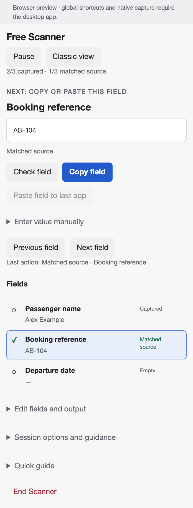

# Focused workflow trial

This guide covers the experimental `codex/focused-workflow` branch. The public 0.8.1 app remains available. This trial changes the working interface without changing the saved-library format.



## Start with a small task

Try one synthetic record before using real work. For example, use two fields:

```text
Passenger name
Booking reference
```

Use `Alex Example` and `AB-104` as the values. You can type them manually; a source application is not required for this first exercise.

1. Open **Free Scanner** at the bottom of Workspace.
2. Choose **Define fields**, enter those two lines, and choose **Start Scanner**.
3. The heading identifies the task. The next-action line tells you what to do with the active field. The checklist shows all fields and their state.
4. **Enter value manually** starts open in Scanner. Paste or type `Alex Example` and choose **Capture value**. Capture advances to the next empty field when automatic advancement is enabled.
5. Enter `AB-104` for Booking reference.

For real work, open a saved row from a table instead. The task heading shows the table and row title, when present. Table fields and existing values are loaded into Scanner. Previously saved values need a fresh source check when verification is required.

## Capture from another application

Select the intended text in the source app, then use **Capture selection** or the capture shortcut shown above the controls. The mouse action returns to the most recent source app to capture the selection. You can also copy in the source app and choose **Use clipboard**, paste into the manual text box, or paste onto a selected field.

On Windows, the default global capture shortcut is **Ctrl+Alt+1**. On Mac it is **Cmd+Option+1**. Custom bindings still apply. Browser preview supports manual entry and ordinary clipboard operations; native cross-app capture requires the desktop app.

Capture can replace the clipboard. The existing optional clipboard-restoration setting remains available under **Session options and guidance**.

## Check a value against its source

1. Select **Booking reference** in the checklist.
2. Choose **Check field**.
3. Select the original reference again and use **Compare selection**, or paste a fresh source copy into the manual entry box and choose **Compare value**.
4. Try `AB-1O4` in the exercise. The mismatch shows both versions and highlights the differing part. The captured value stays `AB-104`.
5. Compare `AB-104`. The field becomes **Matched source**.

“Matched source” means the two selections agree under the current comparison rules. It does not establish that you selected the right booking or person. It does not check the destination. Exact and whitespace-tolerant rules still work as before.

**Edit fields and output** contains **Reverify selected field** and **Reverify all filled fields**. Both preserve captured text. Editing a value invalidates its source match. Optional green backgrounds apply only to matched fields and remain off by default.

## Copy or paste a checked value

Select a field, then choose **Copy field**, or press **Ctrl+C** / **Cmd+C** while its checklist button has focus. Required verification still applies. Native text-selection copying and pasting inside text boxes remain unchanged.

Paste into the destination app with its usual Paste action. The desktop **Paste field to last app** action is also available: put the caret in the destination first, then return to VeraFlow and request the paste.

The **Last action** line distinguishes:

| Message                                  | What it establishes                                                                                             |
| ---------------------------------------- | --------------------------------------------------------------------------------------------------------------- |
| Captured                                 | VeraFlow accepted text into the named field.                                                                    |
| Matched source                           | A comparison passed under the configured rules.                                                                 |
| Copied to clipboard                      | The clipboard write completed.                                                                                  |
| Paste requested; destination not checked | The paste adapter returned without an error; inspect the destination yourself.                                  |
| Paste uncertain                          | A paste operation failed or could not be confirmed. It may already have inserted text. Inspect before retrying. |
| Advanced manually; paste not confirmed   | VeraFlow moved its email position; that action did not paste anything.                                          |

The line records the latest action in this session, not a permanent history. Its wording does not change if you later edit a value: consult the field’s current state for whether it still matches its source.

## Pause and return after an interruption

Choose **Pause**. VeraFlow returns to Workspace and shows a recap: task name, captured/matched counts, active field, and last action. Session capture shortcuts are suspended, and source-window tracking for the paused session stops. If you separately use snippets in Workspace, their existing source-window tracking may run.

Choose **Resume task** to return. The active field, comparison mode, mismatch, captured values, email position, and unfinished manual typing are retained. Moving to another main page from Classic view also pauses the task. An unresolved shortcut conflict on resume reports an error while leaving manual entry available.

**Pause is not Save.** It keeps work only while the app is running. Quitting, restarting, or clearing a session erases temporary work. Quit and update guards still apply. Use **Edit fields and output → Save row** or **Save as new table row** when you want captured values saved locally. A row save stores captured values, not an in-progress comparison or unfinished typing. Free Scanner never starts saving automatically.

## Templates and email

Templates still live under **Templates** for this trial. Start one as usual. The focused view uses the same capture and verification rules; templates with verification enabled enter their second pass after capture. Once ready, choose **Copy result**, **Preview**, or **Prepare email output**.

Email output shows the configured section order as a checklist. Place focus in the correct destination field. Use the configured output shortcut (**Ctrl+Alt+8** on Windows by default) once per section to request a paste and advance. Body has no trailing Tab. VeraFlow never sends the email.

**Next section (manual)** and **Previous section (manual)** move only VeraFlow’s position. Use them to recover after inspecting or manually filling the destination. Each section records copied/requested/uncertain/manual status separately; none of these means the destination has been checked. Pause/resume preserves this checklist within the running app.

After finishing email output, **Open fields in Scanner** remains available for individual transfer. **Clear fields and close** erases the temporary session.

## Switch back or stop the trial

Choose **Classic view** at the top of the working window. Choose **Focused view** to return. Switching preserves captured values, matches, active field, and unfinished manual entry. The choice lasts for the current app run; this branch starts in Focused view on its next launch.

The branch adds no saved-library properties or migrations. To return to the public app, close the test app and open the public version. Keep a backup before experimenting, since explicitly editing/saving/deleting rows or templates still changes the library of the app you are using.

For Windows, the branch’s **Check** workflow produces an isolated **VeraFlow Test** installer after all checks pass. It uses a separate library and cannot install public updates. Export/import synthetic tables or templates explicitly to try them there. The public app and its update feed are unchanged. Test artifacts expire after 14 days and require GitHub sign-in to download.

For a local developer preview, check out this branch and run `npm ci`, then `npm run desktop` (native app) or `npm run dev` (browser-only preview). A browser URL ending in `/?workflow=classic` starts directly in Classic view; the ordinary URL starts Focused view. No keyboard shortcuts need to be reconfigured.

## What to evaluate

Try a short real Windows task and interrupt it halfway through. Check whether you can:

- Identify the record and next field immediately on returning.
- Find an unchecked field without rereading every value.
- Correct a mismatch without recapturing unrelated fields.
- Recover from an uncertain paste without duplicating text.
- Switch layouts without losing work.
- Work at your preferred narrow width without horizontal scrolling.

This trial does not add persistent session drafts, internal Undo, destination-content inspection, macros, or a unified Scanner/template/email data model. Those remain possible later steps, after testing whether the focused workflow helps.
